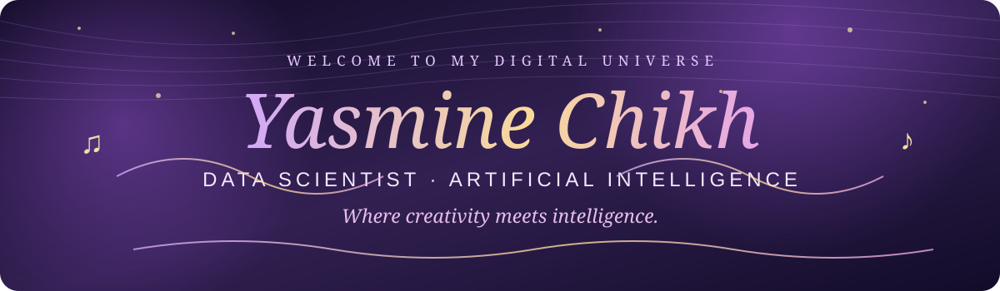
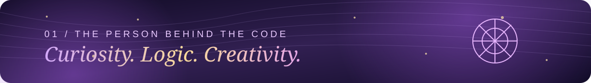
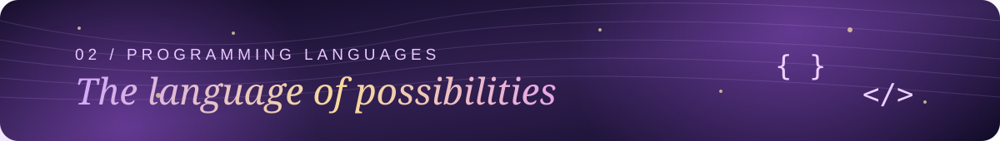
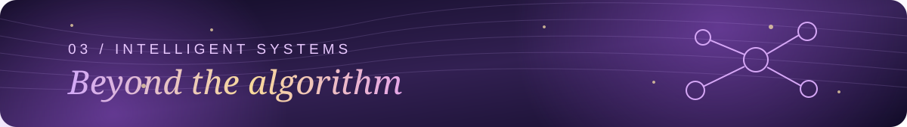
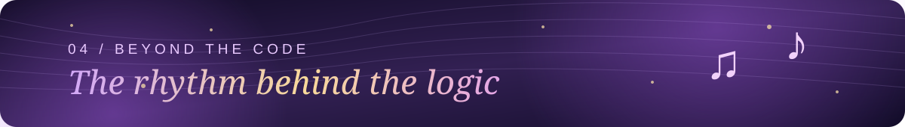

 

**Data Scientist** &nbsp; ✦ &nbsp; **AI & Intelligent Systems** &nbsp; ✦ &nbsp; **Musician & Singer**

 

I'm **Yasmine Chikh**, a Data Scientist pursuing a Master's degree in Artificial Intelligence at **Université Paris 8**. I enjoy exploring how mathematical reasoning, data, and intelligent systems can turn ambitious ideas into meaningful solutions.

My interests include **large language models, agentic AI, retrieval-augmented generation, and deep learning** — always with a curiosity for how systems work and how they can be improved.

 

  

**`Python`** &nbsp; ✦ &nbsp; **`C++`** &nbsp; ✦ &nbsp; **`SQL`** &nbsp; ✦ &nbsp; **`SAS`**

 

| Generative Intelligence | Agentic Intelligence |
| :---: | :---: |
| **Large Language Models (LLMs)** | **AI Agents** |
| **Generative AI** | **Agentic RAG** |
| **Retrieval-Augmented Generation** | **Tool-Using AI Systems** |

**Machine Learning** &nbsp; · &nbsp; **Deep Learning** &nbsp; · &nbsp; **Natural Language Processing**

 

### ♫ Music is part of my story

Beyond code and algorithms, I'm also a **musician and singer**. Music is another language through which I explore patterns, expression, and creativity.

*Where data, intelligence, and music harmonize.*

 

✦ **THINK · CREATE · INNOVATE** ✦

